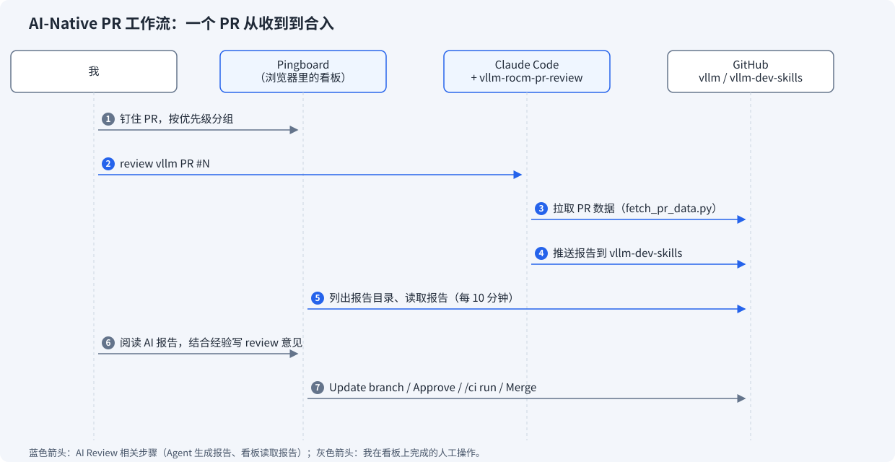
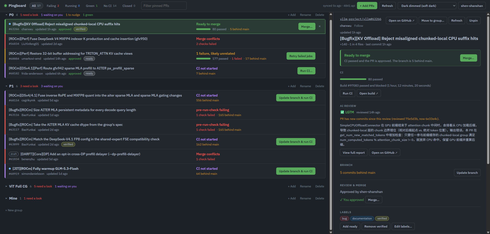
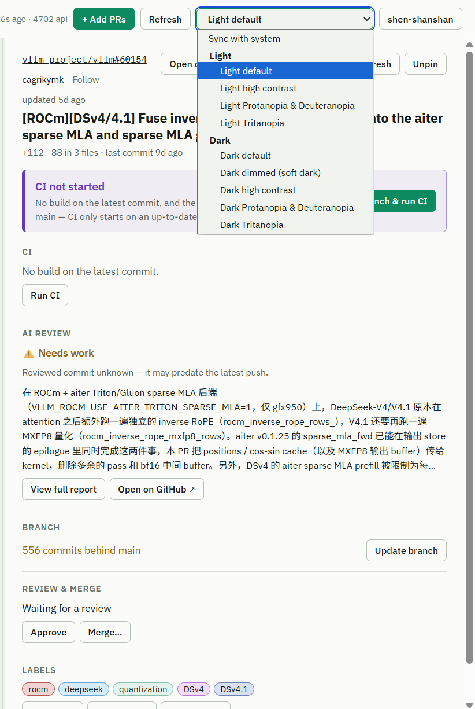
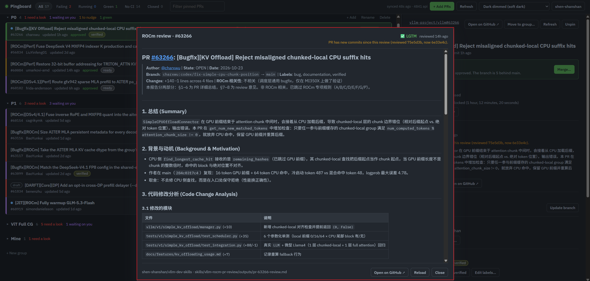
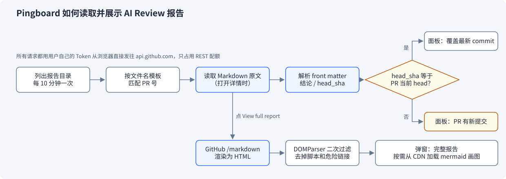

## 一、引言

作为 AMD ROCm 团队在 vLLM 社区的 Maintainer 之一，我的日常工作中很大一部分时间花在处理同事和社区开发者提交的 PR 上：理解改动、给出 Review 意见、触发 CI、盯 CI 结果、最后合入。

成为 Maintainer 之前，我只负责社区里的少数几个模块，如：Encoder CUDA Graph 特性、多硬件后端的兼容性和可移植性等。成为 Maintainer 之后，所有 AMD 同事提交的 PR 都需要我来 Review，这带来了两个很现实的问题：

- **理解成本高**：很多 PR 涉及的模块我并不熟悉（比如 AITER 算子、MoRI 通信、某个新模型的 MLA 实现）。在给出 Review 意见之前，我往往要先花大量时间去补相关的代码和设计背景，然后才能真正开始 Review；
- **管理成本高**：Review 请求来自 Teams 私信、工作群里的 @、Slack 等各种渠道，消息一多，就很容易漏掉某个 PR，或者看过之后忘了继续跟进（触发 CI、合入）。浏览器里也常常同时开着十几个 PR 的 Tab，非常混乱。

为了解决这两个问题，我逐步搭起了一套 AI-Native 的 PR 工作流：用 Claude Code 运行我自己编写的 `vllm-rocm-pr-review` Skill 来生成 PR 的总结和 Review 报告，再用一个 PR 看板（基于 Pingboard 改造）把所有待处理的 PR、CI 状态和 AI 报告集中到一个页面上。本文将介绍这套工作流是怎么运转的，以及背后的两个工具是如何实现的。

## 二、整体工作流

老规矩，先上图：



具体地，一个 PR 在我这里会经历以下几步：

1. **收进看板**：有新的 PR 需要我 Review 时，不管它来自哪个渠道，我都会先把它钉到看板上，并按紧急程度放进不同的分组（分组可以自由创建、拖拽调整）。从这一刻起，这个 PR 就不会再被遗漏了；
2. **生成 AI 报告**：让 Agent（Claude Code）运行 `vllm-rocm-pr-review` Skill。Skill 会拉取 PR 的 Diff、讨论和 CI 状态，生成一份中文的总结 + Review 报告，并推送到我的 [`vllm-dev-skills`](https://github.com/shen-shanshan/vllm-dev-skills) 仓库；
3. **看板读取报告**：看板会定期去这个仓库查看哪些 PR 已经有了报告，点开 PR 详情就能直接看到；
4. **人工 Review**：等我有空的时候，按优先级从高到低依次打开 PR，先读 AI 报告补齐背景，再结合自己的经验给出 Review 意见；
5. **在看板上推进**：Update Branch（同步最新的 Main）、Approve、触发 CI、监控 CI 进度、Merge，全部在看板上完成，不需要再分别打开每个 PR 的页面。

其中第 2、3 步是 AI 参与的部分（图中蓝色箭头），其余是我自己的操作。值得注意的是，AI 报告只是 Review 的输入，最终的 Review 意见仍然由我来判断和给出。

下面分别介绍看板和 Skill 这两个工具。

## 三、用 Pingboard 管理 PR

### 3.1 一个 PR 一行

看板基于 [`mgoin/pingboard`](https://github.com/mgoin/pingboard) 改造而来，我 Fork 了一份并部署在 [GitHub Pages](https://shen-shanshan.github.io/vllm-maintainer-shepherd-dashboard/) 上。它是一个纯静态页面：没有后端，也不需要构建，浏览器拿着用户自己的 GitHub Token 直接调用 GitHub API。这意味着部署成本几乎为零，任何人 Fork 一下就能拥有自己的看板。



看板上每个 PR 占一行，用一句话直接告诉你它现在处于什么状态、下一步该做什么：

| 状态 | 含义 | 看板上的按钮 |
|---|---|---|
| `CI not started` | 最新 Commit 还没跑 CI | `Run CI`；分支落后时是 `Update branch & run CI` |
| `CI running` | CI 正在跑 | — |
| `N failures to look at` | 有失败的 Job，且在别处没见过 | — |
| `N failures, likely unrelated` | 失败的 Job 在 Main 或其他 PR 上也失败过 | `Retry failed jobs` |
| `CI passed · needs review` | CI 全绿，等待 Review | — |
| `Ready to merge` | CI 全绿且已 Approve | `Merge…` |
| `Merge conflicts` | 有冲突，需要作者处理 | — |

这样，我每天打开看板时只需要扫一眼状态列：哪些 PR 卡在 CI、哪些已经可以合、哪些在等我 Review，一目了然。PR 自我上次查看之后有变化的，还会亮一个蓝点。

### 3.2 失败到底跟这个 PR 有没有关系？

盯 CI 时最耗时间的，往往是判断“这个红色的 Job 是 PR 自己引入的，还是 Main 上本来就挂着的 Flaky 用例”。Pingboard 在这一点上做得很巧妙：由于静态页面读不到 Buildkite 的日志，它只用 GitHub 上已有的信息来判断。

- **`N/M on base`**：扫描 Base 分支最近 30 个跑过 CI 的 Commit，统计同一个 Job 失败了几次。比如 `3/20 on base` 表示这个 Job 在最近 20 个跑完 CI 的 Main Commit 上失败过 3 次；
- **`also #123 #456`**：同一个 Job 在看板上其他 PR 里也在失败。

只要有任意一条证据，这个失败就会被归为 `likely unrelated`，看板上直接给出 Retry 按钮；否则归为 `to look at`，需要我去看日志。这样，大部分 Flaky 失败都能在看板上一键重试，不需要逐个点进 Buildkite。

### 3.3 所有操作都在一个界面里

Update Branch、Approve、`/ci run`、`/ci retry`、打 Label、Merge 都是看板上的按钮，并且都有快捷键。发评论和更新分支这类操作会先等 3 秒，期间可以撤销，避免误操作。所有操作都用我自己的 Token、以我的身份执行，和我在 GitHub 网页上手动操作没有区别。

在 Fork 版本中，我又陆续加了几个功能：

**（1）主题切换**：参照 GitHub 的 Appearance 设置，支持 Light、Dark、Dark Dimmed（Soft Dark）、高对比和色盲友好等 10 种主题。



**（2）AI Review 面板**：在 PR 详情页展示 Skill 生成的报告，这是第五节的主角。



## 四、用 `vllm-rocm-pr-review` 做 AI Review

### 4.1 Skill 做了什么

[`vllm-rocm-pr-review`](https://github.com/shen-shanshan/vllm-dev-skills/tree/master/skills/vllm-rocm-pr-review) 是我为 Claude Code 编写的一个 Skill，输入一个 vLLM 的 PR 号，输出一份中文报告 `outputs/pr-<NUMBER>-review.md`。报告分为两部分：

- **Part A：PR 详细总结（§1～6）**：总结、背景与动机、代码修改分析（按模块列表格，并用 Mermaid 画出架构图或流程图）、技术原理、讨论亮点、风险表；
- **Part B：ROCm Review 意见（§7～8）**：按严重程度排序、按类型分类（正确性、性能、兼容性、测试等）的问题列表，以及最终结论：🔴 BLOCK、⚠️ NEEDS WORK 或 ✅ LGTM；
- **§9：英文评论**：从最重要的几条问题中整理出 2～5 条可以直接粘贴到 GitHub PR Review 界面的英文评论，并标好文件和 Diff 行号。

为了让 Review 更有针对性，Skill 内部的流程大致是：

1. **拉取数据**：用 `scripts/fetch_pr_data.py` 一次性拉取 PR 的元信息、完整 Diff、讨论、Review 和 CI 状态；
2. **ROCm 相关性判断**：根据标题、描述和改动路径中的 `rocm`、`aiter`、`mori`、`gfx950` 等标记，判断 PR 是否与 ROCm 相关。不相关的 PR 仍然会生成完整的总结，但跳过 ROCm 专项检查；
3. **先理解再检查**：在套用任何规则之前，先回答 5 个问题，比如：计算上到底改了什么、影响哪些硬件和模型、性能提升的机制是什么、PR 描述解释的是"为什么"还是只有"做了什么"；
4. **按 PR 类型套用规则**：规则库改编自 ROCm 的 ATOM 和 AITER 项目中的 Review Skill。改动 Attention 后端、MoE/量化、MoRI 通信、环境变量等不同类型的 PR，必须检查的规则类别也不同。同时，Skill 会按风险把 ROCm 相关文件分为三级（如：Attention 和 MoE 的 AITER 实现属于"可能导致静默数值错误"的第一级），第一级文件一律深度 Review；
5. **AI 代码诊断**：检查引用的 AITER / MoRI 符号是否真实存在、两份几乎一样的代码是否出现了分叉、测试是否只是"为了通过而写"等常见的 AI 生成代码问题。

此外还有几条贯穿始终的纪律，比如：给出 🔴 阻塞性意见之前，必须说出具体的触发输入（Shape、Dtype、架构或配置），说不出来就降级；CI 红了不等于 PR 有问题，要先和 Main 对比；PR 里的 Benchmark 数字找不到来源的，一律标为未验证。

### 4.2 AI 报告在 Review 中的作用

对我来说，这份报告最大的价值是降低理解成本。面对一个不熟悉模块的 PR，我不再需要从零开始读代码，而是先看 Part A：这个 PR 解决什么问题、改了哪些模块、涉及哪些背景知识（如：MLA、PD 分离、MoE 量化、CUDA Graph）。在此基础上再去读 Diff，Review 意见会准确很多。

另一方面，AI 有时能发现人工 Review 很容易漏掉的细节，比如重复的代码、遗漏的分支逻辑、与实现不一致的注释等。

**当然，报告中的结论我不会直接照搬：哪些问题真的值得提、哪些是 AI 的误判，仍然需要结合我自己对代码和社区讨论的了解来判断。**

## 五、把 AI 报告接入看板

到此为止，看板负责“管 PR”，Skill 负责“读懂 PR”，两者还是割裂的：报告生成在另一个仓库里，我得自己去找。最后一步就是把报告接进看板。

### 5.1 为什么用 Git 仓库来传递报告

Pingboard 是纯静态页面，无法调用 Agent 去执行 Skill；而 Skill 依赖本地的 Claude Code 环境，也不适合搬到服务端。因此我选择了一个最简单的方案：报告在本地生成，推送到 GitHub 仓库；看板再用用户的 Token 从这个仓库读取。

这样做有几个好处：不需要新增任何服务；报告天然有版本历史；报告仓库是公开的，任何能访问 GitHub 的人都能看到同一份报告。代价是多了一步推送，不过这一步可以交给 Agent 在 Skill 结束时一起完成。

### 5.2 看板是如何拉取和展示报告的

整个读取流程如下图所示：



具体地：

1. **建立索引**：对每个配置好的报告来源，看板调用 GitHub 的 Contents API 列出报告目录，再用文件名模板（如：`pr-{number}-review.md`）把文件名反解成 PR 号，得到一张"PR 号到报告文件"的映射表。这张表每 10 分钟刷新一次，点顶栏的 Refresh 可以立即刷新；
2. **读取报告**：打开某个 PR 的详情时，如果映射表里有它的报告，看板就读取这份 Markdown 原文。原文按文件的 Blob SHA 缓存，同一份报告不会重复下载；报告更新后 SHA 变了，才会重新读取；
3. **解析元数据**：报告开头有一段 Front Matter，由 Skill 在生成报告时写入：

   ```yaml
   ---
   pr: 52921
   repo: vllm-project/vllm
   head_sha: <review 时 PR head 的完整 SHA>
   verdict: needs-work        # block | needs-work | lgtm
   reviewed_at: 2026-10-24T10:00:00Z
   skill: vllm-rocm-pr-review
   ---
   ```

   看板从中取出结论、Review 时间和 `head_sha`，并抽取报告第 1 节作为摘要。对于加入 Front Matter 之前生成的旧报告，结论会从报告的"结论 (Verdict)"一节中识别；
4. **判断是否过期**：这是我觉得最实用的一点。看板把 `head_sha` 和 PR 当前的 Head Commit 做比较：两者一致，说明报告覆盖了最新的代码；不一致，就提示 `PR has new commits since this review`，并给出两个 Commit 的短 SHA。这样我一眼就能知道，作者在 AI Review 之后有没有又推了新代码，需不需要重新跑一次 Skill；
5. **展示完整报告**：详情页的 AI Review 面板只显示结论徽章、时间、摘要和过期提示；点 `View full report`（或按 `i`）才会打开完整报告。完整报告交给 GitHub 的 `/markdown` 接口渲染，表格、代码块、`#1234` 这类 PR 链接的效果都和在 GitHub 上看一致；插入页面之前，再用 `DOMParser` 过滤一遍脚本和危险链接。报告里的 Mermaid 图则由 Mermaid.js 绘制，它只在报告里确实有图时才从 CDN 加载，加载失败就退回显示源码。

所有请求都由浏览器用我的 Token 直接发给 `api.github.com`，只占用 REST 配额，与看板刷新 PR 状态所用的 GraphQL 配额互不影响。报告来源也是可配置的：在 Settings 里每行写一个来源，以后想把 `vllm-pr-summary` 等其他 Skill 的报告也接进来，加一行配置即可。

## 六、效果

这套工作流对我最直接的影响是 Review 的数量。刚成为 Maintainer 的第一个月，我只 Review 了 10 个左右的 PR，效率很低（当然那段时间本职工作也很忙）。用上这套工作流之后，每个月能 Review 40～80 个 PR 不等。

在管理上，变化同样明显：所有 PR 都集中在一个页面里统一管理、监控进度，我不再担心漏掉哪个同事的 PR，也不用打开一堆网页去逐个检查 CI 是否报错、是否跑完、能不能合入。

放到团队层面来看，在我加入 AMD 之前，AMD 在 vLLM 社区只有 3 位 Maintainer，PR 合入的速度（而不是工程师的开发效率）是制约项目推进的主要瓶颈。现在包括我在内，我们在社区已经有 5 位 Maintainer，并且推动社区设立了 Reviewer 这一角色：有权限 Approve PR 和触发 CI，但没有仓库写权限。人手的增加和工作流的提效叠加在一起，PR 推进速度有了明显改善，也扩大了 AMD 在开源生态中的影响力。

## 七、总结

本文介绍了我作为 vLLM Maintainer 的 AI-Native PR 工作流：用 Pingboard 看板集中管理所有待处理的 PR，并直接在看板上完成同步分支、Approve、触发 CI、合入等操作；用 `vllm-rocm-pr-review` Skill 生成 PR 的总结和 ROCm Review 报告，降低理解陌生模块的成本；最后通过 Git 仓库加 Front Matter 的方式，把 AI 报告接进看板，并借助 `head_sha` 判断报告是否过期。

这套方案的核心思路是：**让 AI 负责“读懂 PR”和“整理信息”，让看板负责“不遗漏、少切换”，而 Review 的判断仍然留给人。**

如果你也在维护一个 PR 量很大的开源项目，可以直接 Fork 看板，再按自己的领域写一个 Review Skill，把两者接起来。

本文用到的 `vllm-rocm-pr-review` 只是 [`vllm-dev-skills`](https://github.com/shen-shanshan/vllm-dev-skills) 中的一个。这个仓库收录了我在 vLLM 开发中沉淀下来的十多个 Claude Code Skill，覆盖了从找活、读代码、设计方案、提交 PR，到性能分析、Code Review、Issue 整理和技术写作的整个开发流程，如：生成 vLLM 特性或模型的源码解读教程、分析某个模块中可以贡献的 Task、生成 vLLM 风格的 PR 描述和 RFC、对比优化前后的 Benchmark 结果等。每个 Skill 都附有 Prompt 示例和真实的输出样例，可以直接拿来用，也可以照着改成适合自己项目的版本。如果它对你有帮助，欢迎 Star 或 Fork，也欢迎关注我的 [GitHub](https://github.com/shen-shanshan)，后续新的 Skill 和实践都会更新在那里。

最后顺带一提，本文也是先由我的 [`vllm-technical-blog-writer`](https://github.com/shen-shanshan/vllm-dev-skills/tree/master/skills/vllm-technical-blog-writer) Skill 根据我口述的要点生成初稿，再由我微调完成的，算是这套 AI-Native 工作流在写作上的一次实践。

## 八、参考资料

- Pingboard：[mgoin/pingboard](https://github.com/mgoin/pingboard)
- 本文的看板 Fork：[shen-shanshan/vllm-maintainer-shepherd-dashboard](https://github.com/shen-shanshan/vllm-maintainer-shepherd-dashboard)
- 看板在线地址：[shen-shanshan.github.io/vllm-maintainer-shepherd-dashboard](https://shen-shanshan.github.io/vllm-maintainer-shepherd-dashboard/)
- Dev Skills 仓库：[shen-shanshan/vllm-dev-skills](https://github.com/shen-shanshan/vllm-dev-skills)
